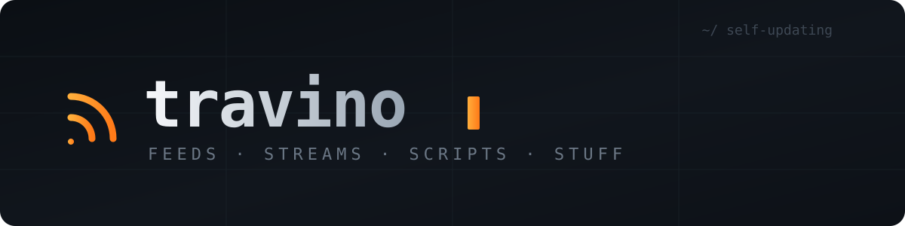

  

 

[Polski](README_pl.md) · **English** · [简体中文](README_zh.md)

 

  
 
  

---

### Ja i moje ziomki

## 🧭 Project map

**Private command center: projects, services, tools, and drawers in one place.**

### Main repositories

| project | entry points | what's inside |
|---|---|---|
| 📡 **Feedseek** | [repo](https://github.com/trvny/feedseek) · [site](https://trvny.github.io/feedseek) · [reader](https://trvny.github.io/feedseek/reader/) | Enhanced RSS/Atom, JSON Feed and Model Feed publishing, including enrichment of native feeds. |
| 🐤 **Kanarek** | [repo](https://github.com/travnie/kanarek) | Android RSS/Atom reader with widgets and radio/IPTV playback. |
| 📺 **TVPI** | [repo](https://github.com/trvny/tvpi) · [site](https://travny.pages.dev/tv/) · [playlist](https://tvpi.travny.workers.dev/playlist.m3u) | Stable IPTV entry points for TVP channels, a Worker, and residential push for refreshing HLS tokens. |
| 🚗 **Autka** | [repo](https://github.com/travnie/Autka) | Android aggregator of car listings from Poland, the EU, and US imports, including import cost calculations. |
| 🤖 **Aistee** | [repo](https://github.com/travnie/aistee) | Kotlin Multiplatform AI workspace combining account-backed WebViews, native/API chats and shared tooling. |
| 🔊 **WAM Bridge** | [repo](https://github.com/travnie/wambridge) | Audio bridge for Samsung Wireless Audio Multiroom speakers and native foobar2000 output for Shape M5. |

### Tools and services

| project | entry | purpose |
|---|---|---|
| 🔳 **[Codebench](https://github.com/travnie/twojstar/tree/main/benches/codebench)** | [codebench.bartek.lol](https://codebench.bartek.lol) | Private browser-based QR and barcode studio. Data never leaves the browser. |
| 📻 **[Streambench](https://github.com/travnie/twojstar/tree/main/benches/streambench)** | [streambench.bartek.lol](https://streambench.bartek.lol) | Workshop for testing, organizing, and playing IPTV, radio, HLS, M3U, and XMLTV. |
| 📄 **[Docbench](https://github.com/travnie/twojstar/tree/main/benches/docbench)** | [docbench.bartek.lol](https://docbench.bartek.lol) | Local-first document and PDF studio for editing, previewing, validating, merging, page operations, and bookmarks. |
| 🏠 **[TRAVNY hub](pages/)** | [travny.pages.dev](https://travny.pages.dev) | Public hub: TV page, weather, feeds and texts; Cloudflare Pages project `travny` built from `pages/`. |
| 🌦️ **[weather-feed](https://github.com/travnie/twojstar/tree/main/weather-feed)** | [weather.bartek.lol](https://weather.bartek.lol) | Multi-source weather and IMGW alerts for Kościelec/Chrzanów, exposed as Atom and JSON. |
| 🩺 **[status-mcp](mcp/status-mcp/)** | MCP | One tool for aggregate health checks of TVPI, Feedseek, Weather, and Autka. |
| 🐾 **[Pet Dispatcher](mcp/pet-dispatcher/)** | local MCP + Worker | Workspace-confined development-machine tools with an outbound-only Cloudflare control plane. |
| 🌀 **[Loopling](https://github.com/travnie/twojstar/tree/main/pets/loopling)** | ChatGPT/Codex pet | Procedurally generated desktop pet, installers, previews, and validation assets. |
| 🤖 **[AI core](https://github.com/trvny/.ai)** | [.ai/](.ai/) | Public AI configuration core + private profile, archive, and project skills. |

### 🗄️ Drawers

[`playlists`](stuff/playlists/) · [`configs`](stuff/configs/) ·
[`feeds`](stuff/feeds/) · [`quotes`](https://gist.github.com/trvny/167d2271e3cf7d21e118aa7d906a7d2c) · [`other`](stuff/other/)

- **Playlists**: working and test M3U/M3U8 files for Streambench and players.
- **Configs**: shared pieces that are not worth putting in a separate repository.
- **Feeds and quotes**: helper sources used by automations and widgets.

### 🧪 Other repositories

| repo | role |
|---|---|
| [WiFi-Automatic](https://github.com/trvny/WiFi-Automatic) | fork of an Android app that automates Wi-Fi radio state |

## [License](LICENSE) 

[ISC](https://spdx.org/licenses/ISC). [THIRD_PARTY_NOTICES](docs/THIRD_PARTY_NOTICES.md).

---
## 💬 Quote from the drawer

<!-- markdownlint-disable MD033 -->
<!--STARTS_HERE_QUOTE_README-->
<i>❝Study me as much as you like, you will not know me, for I differ in a hundred ways from what you see me to be. Put yourself behind my eyes and see me as I see myself, for I have chosen to dwell in a place you cannot see. — Rumi❞</i>
<!--ENDS_HERE_QUOTE_README-->
<!-- markdownlint-enable MD033 -->

## 📰 Recently on the air

<!--README_FEED:START-->
- [Like A Complete \(Known\) Unknown? A Brief History of Nuclear Weaponization](https://carnegieendowment.org/research/2026/11/a-brief-history-of-nuclear-weaponization)
- [Ranking graczy GTA 6: top 50 według procentu ukończenia - PSN, Xbox i checklista](https://promptowy.com/gta-6-ranking-graczy/)
- [Quiz GTA 6: wyzwanie dnia i 7 quizów - mapa, auta, 100%, Miami, postacie](https://promptowy.com/gta-6-quiz/)
- [Quiz: prawdziwe Miami czy Leonida z GTA 6? Zgadnij po zdjęciu](https://promptowy.com/gta-6-quiz-miami-czy-leonida/)
- [Quiz GTA 6: czy zrobisz 100%? 12 pytań o progi, kolekcje i trofea](https://promptowy.com/gta-6-quiz-100-procent/)
- [Quiz GTA: ile wiesz o serii Grand Theft Auto? 15 pytań od 1997 roku](https://promptowy.com/quiz-gta/)
<!--README_FEED:END-->

consolidation over fragmentation · po kolei, na spokojnie

