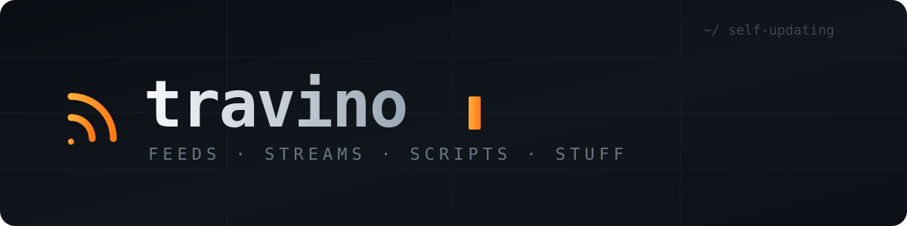

  

 

[Polski](README_pl.md) · **English** · [简体中文](README_zh.md)

 

  
    
  
 
  

---

### Ja i moje ziomki

## 🔀 Open pull requests

<!--OPEN_PRS:START-->
| Repository | PR | Title | Author | State | Updated |
| --- | ---: | --- | --- | --- | --- |
| trvny/trvny | [#1363](https://github.com/trvny/trvny/pull/1363) | deps: update anthropic requirement from >=2.3.0 to >=2.6.0 in /pages/token-worldcup in the pip group | @dependabot[bot] | ready | 2026-11-10 |
| trvny/trvny | [#1364](https://github.com/trvny/trvny/pull/1364) | deps: bump wrangler from 4.156.0 to 4.158.0 in /gh-apps/shitpost-reactor in the cloudflare-toolchain group | @dependabot[bot] | ready | 2026-11-10 |
| trvny/trvny | [#1365](https://github.com/trvny/trvny/pull/1365) | deps: bump wrangler from 4.156.0 to 4.158.0 in /tg-bots/cloudflare-assistant in the cloudflare-toolchain group | @dependabot[bot] | ready | 2026-11-10 |
| trvny/trvny | [#1366](https://github.com/trvny/trvny/pull/1366) | deps: bump the cloudflare-toolchain group in /gh-apps/claudiusz with 2 updates | @dependabot[bot] | ready | 2026-11-10 |
| trvny/trvny | [#1367](https://github.com/trvny/trvny/pull/1367) | deps: bump the cloudflare-toolchain group in /mcp/pet-dispatcher with 2 updates | @dependabot[bot] | ready | 2026-11-10 |
| trvny/trvny | [#1368](https://github.com/trvny/trvny/pull/1368) | deps: bump the cloudflare-toolchain group in /gh-apps/kanarek-review with 2 updates | @dependabot[bot] | ready | 2026-11-10 |
| trvny/trvny | [#1369](https://github.com/trvny/trvny/pull/1369) | deps: bump the npm group in /pages/astro with 2 updates | @dependabot[bot] | ready | 2026-11-10 |
| trvny/trvny | [#1370](https://github.com/trvny/trvny/pull/1370) | deps: bump the cloudflare-toolchain group in /gh-apps/kanarek-companion with 2 updates | @dependabot[bot] | ready | 2026-11-10 |
| trvny/trvny | [#1371](https://github.com/trvny/trvny/pull/1371) | deps: bump @google/genai from 2.32.0 to 3.0.0 in /mcp/pet-dispatcher in the npm group | @dependabot[bot] | ready | 2026-11-10 |
| trvny/WiFi-Automatic | [#64](https://github.com/trvny/WiFi-Automatic/pull/64) | ci: bump step-security/harden-runner from 2.22.3 to 2.22.4 in the actions group | @dependabot[bot] | ready | 2026-11-09 |
| trvny/WiFi-Automatic | [#65](https://github.com/trvny/WiFi-Automatic/pull/65) | deps: bump the gradle group with 2 updates | @dependabot[bot] | ready | 2026-11-09 |
<!--OPEN_PRS:END-->

## 🧭 Project map

**Private command center: projects, services, tools, and drawers in one place.**

### Main repositories

| project | entry points | what's inside |
|---|---|---|
| 📡 **Feedseek** | [repo](https://github.com/trvny/feedseek) · [site](https://trvny.github.io/feedseek) · [reader](https://trvny.github.io/feedseek/reader/) | Enhanced RSS/Atom, JSON Feed and Model Feed publishing, including enrichment of native feeds. |
| 🐤 **Kanarek** | [repo](https://github.com/travnie/kanarek) | Android RSS/Atom reader with widgets and radio/IPTV playback. |
| 📺 **TVPI** | [repo](https://github.com/trvny/tvpi) · [site](https://travny.pages.dev/tv/) · [playlist](https://tvpi.travny.workers.dev/playlist.m3u) | Stable IPTV entry points for TVP channels, a Worker, and residential push for refreshing HLS tokens. |
| 🚗 **Autka** | [repo](https://github.com/travnie/Autka) | Android aggregator of car listings from Poland, the EU, and US imports, including import cost calculations. |
| 🤖 **Aistee** | [repo](https://github.com/travnie/aistee) | Kotlin Multiplatform AI workspace combining account-backed WebViews, native/API chats and shared tooling. |
| 🔊 **WAM Bridge** | [repo](https://github.com/travnie/wambridge) | Audio bridge for Samsung Wireless Audio Multiroom speakers and native foobar2000 output for Shape M5. |

### Tools and services

| project | entry | purpose |
|---|---|---|
| 🔳 **[Codebench](https://github.com/travnie/twojstar/tree/main/benches/codebench)** | [codebench.trfny.com](https://codebench.trfny.com) | Private browser-based QR and barcode studio. Data never leaves the browser. |
| 📻 **[Streambench](https://github.com/travnie/twojstar/tree/main/benches/streambench)** | [streambench.trfny.com](https://streambench.trfny.com) | Workshop for testing, organizing, and playing IPTV, radio, HLS, M3U, and XMLTV. |
| 📄 **[Docbench](https://github.com/travnie/twojstar/tree/main/benches/docbench)** | [docbench.travny.workers.dev](https://docbench.travny.workers.dev) | Local-first document and PDF studio for editing, previewing, validating, merging, page operations, and bookmarks. |
| 🏠 **[TRAVNY hub](pages/)** | [travny.pages.dev](https://travny.pages.dev) | Public hub: TV page, weather, feeds and texts; Cloudflare Pages project `travny` built from `pages/`. |
| 🌦️ **[weather-feed](https://github.com/travnie/twojstar/tree/main/weather-feed)** | [weather.trfny.com](https://weather.trfny.com) | Multi-source weather and IMGW alerts for Kościelec/Chrzanów, exposed as Atom and JSON. |
| 🩺 **[status-mcp](mcp/status-mcp/)** | MCP | One tool for aggregate health checks of TVPI, Feedseek, Weather, and Autka. |
| 🐾 **[Pet Dispatcher](mcp/pet-dispatcher/)** | local MCP + Worker | Workspace-confined development-machine tools with an outbound-only Cloudflare control plane. |
| 🌀 **[Loopling](https://github.com/travnie/twojstar/tree/main/pets/loopling)** | ChatGPT/Codex pet | Procedurally generated desktop pet, installers, previews, and validation assets. |
| 🤖 **[AI core](https://github.com/trvny/.ai)** | [.ai/](.ai/) | Public AI configuration core + private profile, archive, and project skills. |

### 🗄️ Drawers

[`playlists`](stuff/playlists/) · [`configs`](stuff/configs/) ·
[`feeds`](stuff/feeds/) · [`quotes`](https://gist.github.com/trvny/167d2271e3cf7d21e118aa7d906a7d2c) · [`other`](stuff/other/)

- **Playlists**: working and test M3U/M3U8 files for Streambench and players.
- **Configs**: shared pieces that are not worth putting in a separate repository.
- **Feeds and quotes**: helper sources used by automations and widgets.

### 🧪 Other repositories

| repo | role |
|---|---|
| [WiFi-Automatic](https://github.com/trvny/WiFi-Automatic) | fork of an Android app that automates Wi-Fi radio state |

## [License](LICENSE) 

[ISC](https://spdx.org/licenses/ISC). [THIRD_PARTY_NOTICES](docs/THIRD_PARTY_NOTICES.md).

---
## 💬 Quote from the drawer

<!-- markdownlint-disable MD033 -->
<!--STARTS_HERE_QUOTE_README-->
<i>❝More than 80% of the emails sent daily are spams.❞</i>
<!--ENDS_HERE_QUOTE_README-->
<!-- markdownlint-enable MD033 -->

## 📰 Recently on the air

<!--README_FEED:START-->
- [Trust but Verify: Implementing Frontier AI Policy in California and Beyond](https://carnegieendowment.org/research/2026/11/trust-but-verify-implementing-frontier-ai-policy-in-california-and-beyond)
- [Promises Made, Promises Unmet: The NPP’s Struggle to Reform Sri Lanka](https://carnegieendowment.org/research/2026/11/promises-made-promises-unmet-the-npps-struggle-to-reform-sri-lanka)
- [W Filipowicach zagrają cztery kapele - zakliczyninfo.pl](https://news.google.com/atom/articles/CBMijAFBVV95cUxPOXdxVjVMdHc0YUw2akRlZlJZREw0WUVmeHdvbDNqNUo5cnNRM1ZWUm9aSEJzSUlKNU1hSkF2anlwUm5sTGpzTHN1NG9wZXhhSGJYbHB6RWhUaUxlQ3FOTnlwNmloNnJLNnJnbjVmYzJ6RWFqMGdvZ3VzVjJNQUZ4SU9qUzFINjBIQ25BSQ?oc=5)
- [Product of the Day — A Magical Bag Of Holding Except The Only Thing It Can Hold Is Infinite Fedoras](https://anycrap.shop/product/a-magical-bag-of-holding-except-the-only-thing-it-can-hold-is-infinite-fedoras)
- [Cat Fact of the Day](https://catfact.ninja/)
- [Joke of the Day](https://djtech.net/humor/things_to_think_about.htm)
<!--README_FEED:END-->

consolidation over fragmentation · po kolei, na spokojnie

## Contributors ✨

This project follows the [all-contributors](https://github.com/all-contributors/all-contributors) specification. Contributions of any kind welcome!
([emoji key](https://allcontributors.org/docs/en/emoji-key)):

<!-- ALL-CONTRIBUTORS-LIST:START - Do not remove or modify this section -->
<!-- prettier-ignore-start -->
<!-- markdownlint-disable -->
<table>
  <tbody>
    <tr>
      <td align="center" valign="top" width="14.29%"><a href="https://github.com/trvny"> <b>trvny</b></a> <a href="https://github.com/trvny/trvny/commits?author=trvny" title="Code">💻</a> <a href="https://github.com/trvny/trvny/commits?author=trvny" title="Documentation">📖</a> <a href="https://github.com/trvny" title="Maintenance">🚧</a></td>
      <td align="center" valign="top" width="14.29%"><a href="https://github.com/apps/codacy-production"> <b>codacy-production[bot]</b></a> <a href="https://github.com/trvny/trvny/commits?author=codacy-production%5Bbot%5D" title="Code">💻</a> <a href="https://github.com/trvny/trvny/pulls?q=is%3Apr+reviewed-by%3Acodacy-production%5Bbot%5D" title="Reviewed Pull Requests">👀</a></td>
      <td align="center" valign="top" width="14.29%"><a href="https://github.com/apps/coderabbitai"> <b>CodeRabbit</b></a> <a href="https://github.com/trvny/trvny/pulls?q=is%3Apr+reviewed-by%3Acoderabbitai%5Bbot%5D" title="Reviewed Pull Requests">👀</a> <a href="https://github.com/trvny/trvny/commits?author=coderabbitai%5Bbot%5D" title="Code">💻</a></td>
      <td align="center" valign="top" width="14.29%"><a href="https://github.com/apps/github-actions"> <b>github-actions[bot]</b></a> <a href="https://github.com/apps/github-actions" title="Infrastructure">🚇</a></td>
      <td align="center" valign="top" width="14.29%"><a href="https://github.com/apps/dependabot"> <b>dependabot[bot]</b></a> <a href="https://github.com/apps/dependabot" title="Maintenance">🚧</a></td>
      <td align="center" valign="top" width="14.29%"><a href="https://github.com/apps/mergify"> <b>mergify[bot]</b></a> <a href="https://github.com/apps/mergify" title="Maintenance">🚧</a></td>
      <td align="center" valign="top" width="14.29%"><a href="https://github.com/apps/gptomek"> <b>gptomek[bot]</b></a> <a href="https://github.com/trvny/trvny/commits?author=gptomek%5Bbot%5D" title="Code">💻</a> <a href="https://github.com/trvny/trvny/commits?author=gptomek%5Bbot%5D" title="Documentation">📖</a></td>
    </tr>
    <tr>
      <td align="center" valign="top" width="14.29%"><a href="https://github.com/claude"> <b>claude</b></a> <a href="https://github.com/trvny/trvny/commits?author=claude" title="Code">💻</a></td>
      <td align="center" valign="top" width="14.29%"><a href="https://github.com/apps/claudiusz69"> <b>claudiusz69[bot]</b></a> <a href="https://github.com/trvny/trvny/pulls?q=is%3Apr+reviewed-by%3Aclaudiusz69%5Bbot%5D" title="Reviewed Pull Requests">👀</a></td>
      <td align="center" valign="top" width="14.29%"><a href="https://github.com/apps/deepsource-autofix"> <b>deepsource-autofix[bot]</b></a> <a href="https://github.com/trvny/trvny/commits?author=deepsource-autofix%5Bbot%5D" title="Code">💻</a></td>
      <td align="center" valign="top" width="14.29%"><a href="https://github.com/apps/devin-ai-integration"> <b>devin-ai-integration[bot]</b></a> <a href="https://github.com/trvny/trvny/pulls?q=is%3Apr+reviewed-by%3Adevin-ai-integration%5Bbot%5D" title="Reviewed Pull Requests">👀</a></td>
      <td align="center" valign="top" width="14.29%"><a href="https://github.com/actions-user"> <b>actions-user</b></a> <a href="https://github.com/actions-user" title="Infrastructure">🚇</a></td>
      <td align="center" valign="top" width="14.29%"><a href="https://github.com/apps/chatgpt-codex-connector"> <b>chatgpt-codex-connector[bot]</b></a> <a href="https://github.com/trvny/trvny/commits?author=chatgpt-codex-connector%5Bbot%5D" title="Code">💻</a> <a href="https://github.com/trvny/trvny/pulls?q=is%3Apr+reviewed-by%3Achatgpt-codex-connector%5Bbot%5D" title="Reviewed Pull Requests">👀</a></td>
      <td align="center" valign="top" width="14.29%"><a href="https://github.com/apps/sourcery-ai"> <b>sourcery-ai[bot]</b></a> <a href="https://github.com/trvny/trvny/pulls?q=is%3Apr+reviewed-by%3Asourcery-ai%5Bbot%5D" title="Reviewed Pull Requests">👀</a></td>
    </tr>
    <tr>
      <td align="center" valign="top" width="14.29%"><a href="https://github.com/apps/deepsource-io"> <b>deepsource-io[bot]</b></a> <a href="https://github.com/trvny/trvny/pulls?q=is%3Apr+reviewed-by%3Adeepsource-io%5Bbot%5D" title="Reviewed Pull Requests">👀</a> <a href="https://github.com/apps/deepsource-io" title="Security">🛡️</a></td>
      <td align="center" valign="top" width="14.29%"><a href="https://github.com/apps/kanarek-companion"> <b>kanarek-companion[bot]</b></a> <a href="https://github.com/trvny/trvny/pulls?q=is%3Apr+reviewed-by%3Akanarek-companion%5Bbot%5D" title="Reviewed Pull Requests">👀</a> <a href="https://github.com/apps/kanarek-companion" title="Infrastructure">🚇</a></td>
      <td align="center" valign="top" width="14.29%"><a href="https://github.com/apps/copilot-pull-request-reviewer"> <b>copilot-pull-request-reviewer[bot]</b></a> <a href="https://github.com/trvny/trvny/pulls?q=is%3Apr+reviewed-by%3Acopilot-pull-request-reviewer%5Bbot%5D" title="Reviewed Pull Requests">👀</a></td>
      <td align="center" valign="top" width="14.29%"><a href="https://github.com/apps/github-advanced-security"> <b>github-advanced-security[bot]</b></a> <a href="https://github.com/apps/github-advanced-security" title="Security">🛡️</a></td>
      <td align="center" valign="top" width="14.29%"><a href="https://github.com/apps/copilot-swe-agent"> <b>copilot-swe-agent[bot]</b></a> <a href="https://github.com/trvny/trvny/commits?author=copilot-swe-agent%5Bbot%5D" title="Code">💻</a></td>
      <td align="center" valign="top" width="14.29%"><a href="https://github.com/kucharz2026-maker"> <b>kucharz2026-maker</b></a> <a href="https://github.com/kucharz2026-maker" title="Ideas &amp; Planning">🤔</a></td>
      <td align="center" valign="top" width="14.29%"><a href="https://github.com/apps/cubic-dev-ai"> <b>cubic-dev-ai[bot]</b></a> <a href="https://github.com/trvny/trvny/pulls?q=is%3Apr+reviewed-by%3Acubic-dev-ai%5Bbot%5D" title="Reviewed Pull Requests">👀</a></td>
    </tr>
    <tr>
      <td align="center" valign="top" width="14.29%"><a href="https://github.com/apps/greptile-apps"> <b>greptile-apps[bot]</b></a> <a href="https://github.com/trvny/trvny/pulls?q=is%3Apr+reviewed-by%3Agreptile-apps%5Bbot%5D" title="Reviewed Pull Requests">👀</a></td>
      <td align="center" valign="top" width="14.29%"><a href="https://github.com/apps/allcontributors"> <b>allcontributors[bot]</b></a> <a href="https://github.com/trvny/trvny/commits?author=allcontributors%5Bbot%5D" title="Documentation">📖</a></td>
      <td align="center" valign="top" width="14.29%"><a href="https://github.com/codex"> <b>codex</b></a> <a href="https://github.com/trvny/trvny/commits?author=codex" title="Code">💻</a></td>
      <td align="center" valign="top" width="14.29%"><a href="https://github.com/apps/ecc-tools"> <b>ecc-tools[bot]</b></a> <a href="https://github.com/trvny/trvny/pulls?q=is%3Apr+reviewed-by%3Aecc-tools%5Bbot%5D" title="Reviewed Pull Requests">👀</a></td>
      <td align="center" valign="top" width="14.29%"><a href="https://github.com/apps/vercel"> <b>vercel[bot]</b></a> <a href="https://github.com/apps/vercel" title="Infrastructure">🚇</a></td>
      <td align="center" valign="top" width="14.29%"><a href="https://github.com/apps/cloudflare-workers-and-pages"> <b>cloudflare-workers-and-pages[bot]</b></a> <a href="https://github.com/apps/cloudflare-workers-and-pages" title="Infrastructure">🚇</a></td>
      <td align="center" valign="top" width="14.29%"><a href="https://github.com/apps/anthropic-code-agent"> <b>Claude[bot]</b></a> <a href="https://github.com/trvny/trvny/commits?author=Claude%5Bbot%5D" title="Code">💻</a></td>
    </tr>
    <tr>
      <td align="center" valign="top" width="14.29%"><a href="https://github.com/gemini-cli"> <b>gemini-cli</b></a> <a href="https://github.com/trvny/trvny/commits?author=gemini-cli" title="Code">💻</a></td>
      <td align="center" valign="top" width="14.29%"><a href="https://github.com/apps/github-project-automation"> <b>github-project-automation[bot]</b></a> <a href="https://github.com/apps/github-project-automation" title="Maintenance">🚧</a></td>
      <td align="center" valign="top" width="14.29%"><a href="https://github.com/apps/context7"> <b>context7[bot]</b></a> <a href="https://github.com/trvny/trvny/commits?author=context7%5Bbot%5D" title="Documentation">📖</a></td>
    </tr>
  </tbody>
</table>

<!-- markdownlint-restore -->
<!-- prettier-ignore-end -->

<!-- ALL-CONTRIBUTORS-LIST:END -->
