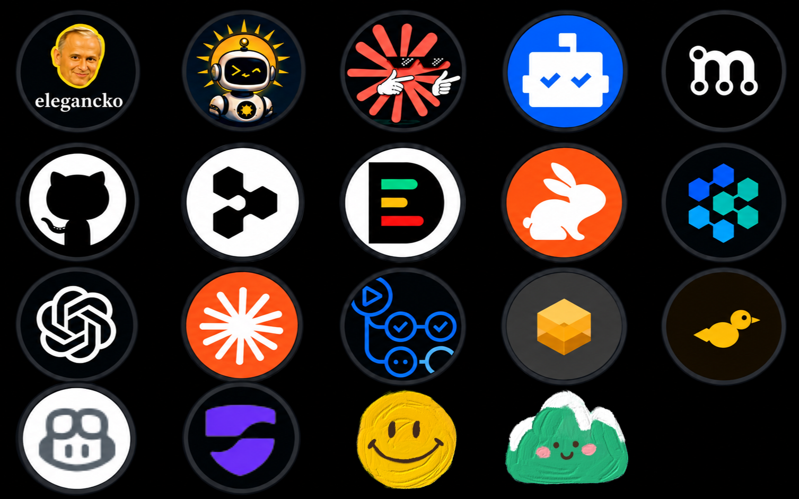

  

 

**Polski** · [English](README.md) · [简体中文](README_zh.md)

 

  
    
  

---

### Ja i moje ziomki

  

## 🔀 Otwarte pull requesty

<!--OPEN_PRS:START-->
| Repozytorium | PR | Tytuł | Autor | Stan | Aktualizacja |
| --- | ---: | --- | --- | --- | --- |
| trvny/trvny | [#1363](https://github.com/trvny/trvny/pull/1363) | deps: update anthropic requirement from >=2.3.0 to >=2.6.0 in /pages/token-worldcup in the pip group | @dependabot[bot] | gotowy | 2026-11-10 |
| trvny/trvny | [#1364](https://github.com/trvny/trvny/pull/1364) | deps: bump wrangler from 4.156.0 to 4.158.0 in /gh-apps/shitpost-reactor in the cloudflare-toolchain group | @dependabot[bot] | gotowy | 2026-11-10 |
| trvny/trvny | [#1365](https://github.com/trvny/trvny/pull/1365) | deps: bump wrangler from 4.156.0 to 4.158.0 in /tg-bots/cloudflare-assistant in the cloudflare-toolchain group | @dependabot[bot] | gotowy | 2026-11-10 |
| trvny/trvny | [#1366](https://github.com/trvny/trvny/pull/1366) | deps: bump the cloudflare-toolchain group in /gh-apps/claudiusz with 2 updates | @dependabot[bot] | gotowy | 2026-11-10 |
| trvny/trvny | [#1367](https://github.com/trvny/trvny/pull/1367) | deps: bump the cloudflare-toolchain group in /mcp/pet-dispatcher with 2 updates | @dependabot[bot] | gotowy | 2026-11-10 |
| trvny/trvny | [#1368](https://github.com/trvny/trvny/pull/1368) | deps: bump the cloudflare-toolchain group in /gh-apps/kanarek-review with 2 updates | @dependabot[bot] | gotowy | 2026-11-10 |
| trvny/trvny | [#1369](https://github.com/trvny/trvny/pull/1369) | deps: bump the npm group in /pages/astro with 2 updates | @dependabot[bot] | gotowy | 2026-11-10 |
| trvny/trvny | [#1370](https://github.com/trvny/trvny/pull/1370) | deps: bump the cloudflare-toolchain group in /gh-apps/kanarek-companion with 2 updates | @dependabot[bot] | gotowy | 2026-11-10 |
| trvny/trvny | [#1371](https://github.com/trvny/trvny/pull/1371) | deps: bump @google/genai from 2.32.0 to 3.0.0 in /mcp/pet-dispatcher in the npm group | @dependabot[bot] | gotowy | 2026-11-10 |
| trvny/WiFi-Automatic | [#64](https://github.com/trvny/WiFi-Automatic/pull/64) | ci: bump step-security/harden-runner from 2.22.3 to 2.22.4 in the actions group | @dependabot[bot] | gotowy | 2026-11-09 |
| trvny/WiFi-Automatic | [#65](https://github.com/trvny/WiFi-Automatic/pull/65) | deps: bump the gradle group with 2 updates | @dependabot[bot] | gotowy | 2026-11-09 |
<!--OPEN_PRS:END-->

**Prywatny hol dowodzenia: projekty, usługi, narzędzia i szuflady w jednym miejscu.**

## 🧭 Mapa projektów

### Główne repozytoria

| projekt | wejścia | co tam siedzi |
|---|---|---|
| 📡 **Feedseek** | [repo](https://github.com/trvny/feedseek) · [strona](https://trvny.github.io/feedseek) · [czytnik](https://trvny.github.io/feedseek/reader/) | Ulepszane RSS/Atom, JSON Feed i Model Feed, również na bazie istniejących źródeł. |
| 🐤 **Kanarek** | [repo](https://github.com/travnie/kanarek) | Androidowy czytnik RSS/Atom, widżety oraz odtwarzacz radia/IPTV. |
| 📺 **TVPI** | [repo](https://github.com/trvny/tvpi) · [strona](https://travny.pages.dev/tv/) · [playlista](https://tvpi.travny.workers.dev/playlist.m3u) | Stabilne wejścia IPTV do kanałów TVP, Worker oraz residential-push do odświeżania tokenów HLS. |
| 🚗 **Autka** | [repo](https://github.com/travnie/Autka) | Androidowy agregator ofert samochodów z Polski, UE i importu z USA, razem z kalkulacją kosztu sprowadzenia. |
| 🤖 **Aistee** | [repo](https://github.com/travnie/aistee) | Wieloplatformowy hub AI w Kotlin Multiplatform: konta w WebView, natywne/API czaty i wspólne narzędzia. |
| 🔊 **WAM Bridge** | [repo](https://github.com/travnie/wambridge) | Most audio do głośników Samsung Wireless Audio Multiroom oraz natywne wyjście foobar2000 dla Shape M5. |

### Narzędzia i usługi

| projekt | wejście | przeznaczenie |
|---|---|---|
| 🔳 **[Codebench](https://github.com/travnie/twojstar/tree/main/benches/codebench)** | [codebench.trfny.com](https://codebench.trfny.com) | Prywatne, przeglądarkowe studio QR i kodów kreskowych. Dane nie opuszczają przeglądarki. |
| 📻 **[Streambench](https://github.com/travnie/twojstar/tree/main/benches/streambench)** | [streambench.trfny.com](https://streambench.trfny.com) | Warsztat do testowania, porządkowania i odtwarzania IPTV, radia, HLS, M3U oraz XMLTV. |
| 📄 **[Docbench](https://github.com/travnie/twojstar/tree/main/benches/docbench)** | [docbench.travny.workers.dev](https://docbench.travny.workers.dev) | Lokalne studio dokumentów i PDF do edycji, podglądu, walidacji, łączenia, operacji na stronach i zakładkach. |
| 🏠 **[TRAVNY hub](pages/)** | [travny.pages.dev](https://travny.pages.dev) | Publiczny hub: strona TV, pogoda, feedy i teksty; projekt Cloudflare Pages `travny` budowany z `pages/`. |
| 🌦️ **[weather-feed](https://github.com/travnie/twojstar/tree/main/weather-feed)** | [weather.trfny.com](https://weather.trfny.com) | Wieloźródłowa pogoda i alerty IMGW dla Kościelca/Chrzanowa, wystawione jako Atom i JSON. |
| 🩺 **[status-mcp](mcp/status-mcp/)** | MCP | Jedno narzędzie do zbiorczego sprawdzania zdrowia TVPI, Feedseek, Weather i Autek. |
| 🐾 **[Pet Dispatcher](mcp/pet-dispatcher/)** | lokalny MCP + Worker | Narzędzia do pracy na maszynie deweloperskiej ograniczone do workspace oraz wychodzący control plane Cloudflare. |
| 🌀 **[Loopling](https://github.com/travnie/twojstar/tree/main/pets/loopling)** | pet ChatGPT/Codex | Proceduralnie generowany desktopowy pet, instalatory, podglądy i walidacja assetów. |
| 🤖 **[AI core](https://github.com/trvny/.ai)** | [.ai/](.ai/) | Publiczny rdzeń konfiguracji AI + prywatny profil, archiwum i projektowe skillsy. |

### 🗄️ Szuflady

[`playlists`](stuff/playlists/) · [`configs`](stuff/configs/) ·
[`feeds`](stuff/feeds/) · [`quotes`](https://gist.github.com/trvny/167d2271e3cf7d21e118aa7d906a7d2c) · [`other`](stuff/other/)

- **Playlisty**: robocze i testowe M3U/M3U8 dla Streambencha oraz odtwarzaczy.
- **Konfiguracje**: rzeczy współdzielone, których nie warto zamykać w osobnym repo.
- **Feedy i cytaty**: źródła pomocnicze używane przez automaty i widżety.

### 🧪 Pozostałe repozytoria

| repo | rola |
|---|---|
| [WiFi-Automatic](https://github.com/trvny/WiFi-Automatic) | fork aplikacji automatyzującej radio Wi-Fi na Androidzie |

## [Licencja](LICENSE) 

[ISC](https://spdx.org/licenses/ISC). [THIRD_PARTY_NOTICES](docs/THIRD_PARTY_NOTICES.md).

---
## 💬 Cytat z szuflady

<!-- markdownlint-disable MD033 -->
<!--STARTS_HERE_QUOTE_README-->
<i>❝Lenovo stands for ‘new legend’. ‘Le’ for legend, and ‘novo’ stands for new.❞</i>
<!--ENDS_HERE_QUOTE_README-->
<!-- markdownlint-enable MD033 -->

## 📰 Ostatnio w eterze

<!--README_FEED:START-->
- [Trust but Verify: Implementing Frontier AI Policy in California and Beyond](https://carnegieendowment.org/research/2026/11/trust-but-verify-implementing-frontier-ai-policy-in-california-and-beyond)
- [Promises Made, Promises Unmet: The NPP’s Struggle to Reform Sri Lanka](https://carnegieendowment.org/research/2026/11/promises-made-promises-unmet-the-npps-struggle-to-reform-sri-lanka)
- [Ma go wiele telefonów. Mało kto wie, do czego służy ten otwór](https://antyweb.pl/maly-otwor-obok-gniazda-ladowania-telefonu-do-czego-sluzy)
- [Tchibo Esperto Mini: mały ekspres BEZ kapsułek, który skradł me serce](https://antyweb.pl/tchibo-esperto-mini-maly-ekspres-bez-kapsulek-ktory-skradl-me-serce)
- [O północy w Porębie Wielkiej samochód wypadł z drogi, uderzył w drzewo i dachował - Gazeta Krakowska](https://news.google.com/atom/articles/CBMiwgFBVV95cUxPSGEwTVpFRU5NQ2diQUVWVUtQVjJUUW85LU9KZXBCTEtFQnlPWk1TOW1xSl9FQUgyd1pvVWxYRjRpbXhJY3d1NXl1UXQtcVp6aHAwS1VtaTg3SEVZZXpPUHVKZmJjRXgzV1ZhR3JELUs5UUFYWktPbmRMek9PSW9TUlFtaGx4TUh5SWk3MnZIYW5sdzFlZ2R6Ry1DbG1fbGZ5SDh2R0U0WGE4aXUwaVpvTTBqQzZLT1FNQWpteGNBU08yUQ?oc=5)
- [Nocny wypadek w Rudzach k. Zatora. Pijana 17-latka Zatorzanka wypadła z jadącego samochodu - Gazeta Krakowska](https://news.google.com/atom/articles/CBMizgFBVV95cUxOQ3pZTlQ4dng5aUtJSENUMEFndnUzcGJCcUVwRVg5RXhsMjZha2o1WjZmZy0zQnB6QVNzaV9TZWFGOG05b0VDUTI3LWVveTVGdl9PNzRpbkktbHBrMGQ1ZXF5R01sbkhxblhoQkwzVnF4RUVTOTNEUFVjY2cybGY3NEhHbHQ0WkRHMUR6Z1djeEVzZDE1TVI5Y1FoNHpkTllLcndVc0pYUVVrNlFXQjJOQW1Idlg3SXJpRDdFMDdocVJEckwyR2NjMWJnR0Zvdw?oc=5)
<!--README_FEED:END-->

consolidation over fragmentation · po kolei, na spokojnie

