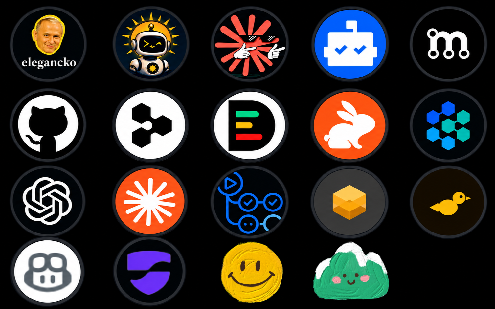

  

 

**Polski** · [English](README.md) · [简体中文](README_zh.md)

 

  

---

### Ja i moje ziomki

  

## 🔀 Otwarte pull requesty

<!--OPEN_PRS:START-->
| Repozytorium | PR | Tytuł | Autor | Stan | Aktualizacja |
| --- | ---: | --- | --- | --- | --- |
| trvny/feedseek | [#667](https://github.com/trvny/feedseek/pull/667) | chore(deps-dev): bump @cloudflare/workers-types from 5.20261120.1 to 5.20261121.1 in /feeds-proxy | @dependabot[bot] | gotowy | 2026-11-25 |
| trvny/feedseek | [#668](https://github.com/trvny/feedseek/pull/668) | chore(deps): bump pydantic from 2.14.3 to 2.14.4 | @dependabot[bot] | gotowy | 2026-11-25 |
| trvny/feedseek | [#669](https://github.com/trvny/feedseek/pull/669) | chore(deps): bump pyyaml from 6.0.3 to 6.0.4 | @dependabot[bot] | gotowy | 2026-11-25 |
| trvny/feedseek | [#670](https://github.com/trvny/feedseek/pull/670) | chore(deps-dev): bump wrangler from 4.162.0 to 4.166.0 in /feeds-proxy | @dependabot[bot] | gotowy | 2026-11-25 |
| trvny/feedseek | [#671](https://github.com/trvny/feedseek/pull/671) | chore(deps-dev): bump ruff from 0.17.5 to 0.17.6 | @dependabot[bot] | gotowy | 2026-11-25 |
| trvny/feedseek | [#672](https://github.com/trvny/feedseek/pull/672) | chore(deps): bump feedparser-rs from 0.7.1 to 0.7.2 | @dependabot[bot] | gotowy | 2026-11-25 |
| trvny/feedseek | [#673](https://github.com/trvny/feedseek/pull/673) | chore(deps): bump astral-sh/setup-uv from 10.3.3 to 10.4.0 in the actions group | @dependabot[bot] | gotowy | 2026-11-25 |
| trvny/tvpi | [#150](https://github.com/trvny/tvpi/pull/150) | chore(deps-dev): bump wrangler from 4.162.0 to 4.166.0 in /worker in the worker-toolchain group | @dependabot[bot] | gotowy | 2026-11-25 |
<!--OPEN_PRS:END-->

**Prywatny hol dowodzenia: projekty, usługi, narzędzia i szuflady w jednym miejscu.**

## 🧭 Mapa projektów

### Główne repozytoria

| projekt | wejścia | co tam siedzi |
|---|---|---|
| 📡 **Feedseek** | [repo](https://github.com/trvny/feedseek) · [strona](https://trvny.github.io/feedseek) · [czytnik](https://trvny.github.io/feedseek/reader/) | Ulepszane RSS/Atom, JSON Feed i Model Feed, również na bazie istniejących źródeł. |
| 🐤 **Kanarek** | [repo](https://github.com/travnie/kanarek) | Androidowy czytnik RSS/Atom, widżety oraz odtwarzacz radia/IPTV. |
| 📺 **TVPI** | [repo](https://github.com/trvny/tvpi) · [strona](https://travny.pages.dev/tv/) · [playlista](https://tvpi.travny.workers.dev/playlist.m3u) | Stabilne wejścia IPTV do kanałów TVP, Worker oraz residential-push do odświeżania tokenów HLS. |
| 🚗 **Autka** | [repo](https://github.com/travnie/Autka) | Androidowy agregator ofert samochodów z Polski, UE i importu z USA, razem z kalkulacją kosztu sprowadzenia. |
| 🤖 **Aistee** | [repo](https://github.com/travnie/aistee) | Wieloplatformowy hub AI w Kotlin Multiplatform: konta w WebView, natywne/API czaty i wspólne narzędzia. |
| 🔊 **WAM Bridge** | [repo](https://github.com/travnie/wambridge) | Most audio do głośników Samsung Wireless Audio Multiroom oraz natywne wyjście foobar2000 dla Shape M5. |

### Narzędzia i usługi

| projekt | wejście | przeznaczenie |
|---|---|---|
| 🔳 **[Codebench](https://github.com/travnie/twojstar/tree/main/benches/codebench)** | [codebench.bartek.lol](https://codebench.bartek.lol) | Prywatne, przeglądarkowe studio QR i kodów kreskowych. Dane nie opuszczają przeglądarki. |
| 📻 **[Streambench](https://github.com/travnie/twojstar/tree/main/benches/streambench)** | [streambench.bartek.lol](https://streambench.bartek.lol) | Warsztat do testowania, porządkowania i odtwarzania IPTV, radia, HLS, M3U oraz XMLTV. |
| 📄 **[Docbench](https://github.com/travnie/twojstar/tree/main/benches/docbench)** | [docbench.bartek.lol](https://docbench.bartek.lol) | Lokalne studio dokumentów i PDF do edycji, podglądu, walidacji, łączenia, operacji na stronach i zakładkach. |
| 🏠 **[TRAVNY hub](pages/)** | [travny.pages.dev](https://travny.pages.dev) | Publiczny hub: strona TV, pogoda, feedy i teksty; projekt Cloudflare Pages `travny` budowany z `pages/`. |
| 🌦️ **[weather-feed](https://github.com/travnie/twojstar/tree/main/weather-feed)** | [weather.bartek.lol](https://weather.bartek.lol) | Wieloźródłowa pogoda i alerty IMGW dla Kościelca/Chrzanowa, wystawione jako Atom i JSON. |
| 🩺 **[status-mcp](mcp/status-mcp/)** | MCP | Jedno narzędzie do zbiorczego sprawdzania zdrowia TVPI, Feedseek, Weather i Autek. |
| 🐾 **[Pet Dispatcher](mcp/pet-dispatcher/)** | lokalny MCP + Worker | Narzędzia do pracy na maszynie deweloperskiej ograniczone do workspace oraz wychodzący control plane Cloudflare. |
| 🌀 **[Loopling](https://github.com/travnie/twojstar/tree/main/pets/loopling)** | pet ChatGPT/Codex | Proceduralnie generowany desktopowy pet, instalatory, podglądy i walidacja assetów. |
| 🤖 **[AI core](https://github.com/trvny/.ai)** | [.ai/](.ai/) | Publiczny rdzeń konfiguracji AI + prywatny profil, archiwum i projektowe skillsy. |

### 🗄️ Szuflady

[`playlists`](stuff/playlists/) · [`configs`](stuff/configs/) ·
[`feeds`](stuff/feeds/) · [`quotes`](https://gist.github.com/trvny/167d2271e3cf7d21e118aa7d906a7d2c) · [`other`](stuff/other/)

- **Playlisty**: robocze i testowe M3U/M3U8 dla Streambencha oraz odtwarzaczy.
- **Konfiguracje**: rzeczy współdzielone, których nie warto zamykać w osobnym repo.
- **Feedy i cytaty**: źródła pomocnicze używane przez automaty i widżety.

### 🧪 Pozostałe repozytoria

| repo | rola |
|---|---|
| [WiFi-Automatic](https://github.com/trvny/WiFi-Automatic) | fork aplikacji automatyzującej radio Wi-Fi na Androidzie |

## [Licencja](LICENSE) 

[ISC](https://spdx.org/licenses/ISC). [THIRD_PARTY_NOTICES](docs/THIRD_PARTY_NOTICES.md).

---
## 💬 Cytat z szuflady

<!-- markdownlint-disable MD033 -->
<!--STARTS_HERE_QUOTE_README-->
<i>❝The most original authors are not so because they advance what is new, but because they put what they have to say as if it had never been said before. — Johann Wolfgang von Goethe❞</i>
<!--ENDS_HERE_QUOTE_README-->
<!-- markdownlint-enable MD033 -->

## 📰 Ostatnio w eterze

<!--README_FEED:START-->
- [Remont zamknie 1,7 km ul. Jurajskiej. Objazd w Rudnie poprowadzi Zamkową - Fakty Krakowa](https://news.google.com/atom/articles/CBMirAFBVV95cUxNWFkxc1pEMy14QWRmSWQzRFkxdnRyVGhiWkhjRzNzeXRISE4taU82R0I0QU1Kc0xibVRwLUxzSlRfMEl3WmgtSU9PU2dNOEI3bExHWWdrMEkxLTlieDZLamRHMkNXaVA0bS1OTUxpUXAyQ2h1Nm8wUFE4Y2M1a3lCaHc1X2x6QUpnMGhMUXVZOTN6T0QtV01EQWNfXzBBcTVlRXYtcTNOYjBGckZo?oc=5)
- [FCC wydało zgodę na kosmiczny superkomputer. SpaceX ma czas do 2040 roku](https://antyweb.pl/fcc-wydalo-zgode-na-kosmiczny-superkomputer-spacex-ma-czas-do-2040-roku)
- [Grasz w GTA VI na PS5? Twoja konsola może… spłonąć](https://antyweb.pl/grasz-w-gta-vi-na-ps5-twoja-konsola-moze-splonac)
- [Problem z baterią w One UI 9.0. Samsung obiecuje poprawkę](https://antyweb.pl/problem-z-bateria-w-one-ui-9-0-samsung-obiecuje-poprawke)
- [W OpenAI i Anthropic czają się potwory. Te firmy boją się je wypuścić na świat](https://antyweb.pl/anthropic-openai-koniec-swiata-ai)
- [Koniec muzycznego spamu. 29 milionów utworów AI znika ze streamingu](https://antyweb.pl/koniec-muzycznego-spamu-29-milionow-utworow-ai-znika-ze-streamingu)
<!--README_FEED:END-->

consolidation over fragmentation · po kolei, na spokojnie

