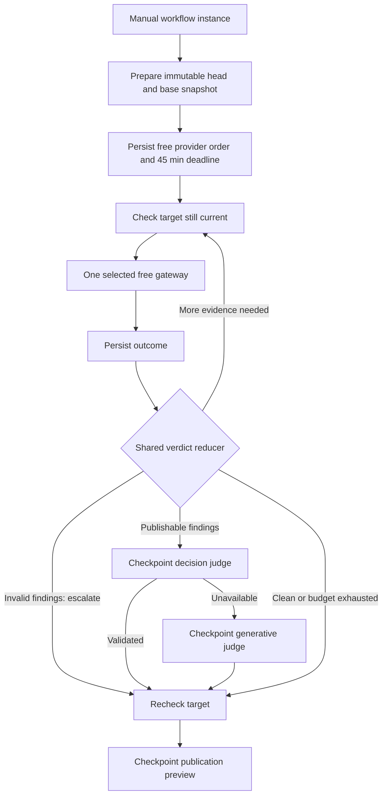

# Review Workflow prototype

Draft. No webhook activation, paid inference, status mutation or review
publication.

## Flow

- Existing context collection, review prompt, verifier, cooldown store and
  provider order.
- Shared sweep verdict reducer; legacy DO scheduling unchanged.
- One provider per durable step; 7 min request ceiling, 8 min step timeout.
- No automatic Workflow step retry; router model fallback remains enabled.
  Completed checkpoints replay without new API calls.
- Persisted snapshot/outcome: outer JSON under 900 KB, line sets explicitly
  serialized.
- Empty or malformed free order fails closed; unavailable gateways advance to
  the next step.
- Freshness checks: at most 30 seconds, bounded by remaining sweep budget.
- Deadline expiry during freshness or the last request persists a budget stop.
- Free-only alias + strict provider selection. Workers AI disabled for L1/L2.
- Route checkpoint requires router capability flag; old deployments fail closed.
- L2 decision: 40s; generative fallback: 5 min, separate from free budget.
- Head freshness before each judge; fail open on inference errors only.
- Shared publication planner, legacy GitHub submission unchanged.
- Preview checkpoints metadata only: comment, silent, escalate or skip.
- Manual instances enforce both repository allowlists.
- GitHub fetches are read-only except installation-token minting.
- Integration test: real preparation, strict binding calls and checkpoint replay.
- Diagnostic result is not a published or certified review.

## Manual binding smoke

Start an instance with params `{"mode":"binding-smoke"}` once both Workers
are deployed and router health reports at least one configured non-Workers-AI
free review provider. Expect mode `binding-smoke`, status `completed` and a positive
provider count. Only router health and synthetic checkpoint serialization;
no GitHub access or inference. Legacy alarms remain active.

## Managed lifecycle (inactive)

- Private `KanarekReviewWorkflowControl.manage(start|status|cancel|resume, job)`.
- `KANAREK_REVIEW_WORKFLOW_MANAGED_ENABLED=false` by default; no public route.
- Bind a trusted operator Worker to service `automation`, entrypoint
  `KanarekReviewWorkflowControl` before using control; no caller binding or public
  route in this rollout.
- Per-PR review DO persists reservation and observed terminal receipt; stable
  SHA-256 instance ID (repo, PR, head, base). Unknown create reconciles by ID,
  never recreates. Concurrent missing status does not revoke an in-flight create.
  Poll status before instance retention expires.
- One active instance; new target rejected until previous termination. Freshness
  check before start/resume. Accepted legacy enqueue invalidates overlapping
  reservations and cancels stale managed work only when control enabled.
  No Workflow restart of completed/errored instances.
- Managed payload binds to actual Workflow instance ID; DO permission required
  before preparation and each new inference stage. Revocation survives restart.
  In-flight requests may finish; cancellation cannot undo sent provider I/O.
- Final managed Workflow step persists bounded completion metadata in its PR DO
  without operator polling. Exact replay is idempotent; conflicting replay fails.
  Cancellation or supersession rejects the write. This is not engine completion,
  paid authorization or publication; reconcile engine status separately.
- Terminal receipts retain metadata only. Unknown create with no retrievable
  instance needs explicit operator reconciliation; no automatic reset.
- No automatic starts, paid calls, status gating or publication.

## Paid-stage receipt (not activated)

- Reserve in the PR DO before the paid submission. Existing reserved, settled
  or uncertain record blocks every replay, even after a crash.
- Private versioned paid-once router path; skip unavailable candidates before
  I/O, no fallback after the first submission. Legacy routes unchanged.
- Store bounded verified publication plan or stop receipt; no GitHub writes.
- Activation requires exclusive DO ownership and verified free escalation in the
  reservation transaction. Paid stage refuses active/unset legacy flag. No
  callable paid entrypoint in this rollout.
- Failed paid-once router responses are conservatively uncertain, even if a
  billed provider is identified. A successful, parsed but invalid review can settle.
- xAI uses a separate non-agentic single-submission RPC; older bindings fail closed.
- A reserved/uncertain receipt requires manual reconciliation, never retry.

## Rollback

- Keep the existing `WebhookReviewJob` alarm and `runWebhookReview` live.
- No production scheduler switch in this prototype. Manual Workflow only.
- Future opt-in must default to the alarm path; drain or cancel Workflow
  instances before switching back. Never publish from both runners.

## Before activation

- Deploy router with strict selector before manual smoke. Keep it deployed
  while prototype instances run. Cancel or drain instances before rollback.
- Validate Workflow CPU and state size on Free tier with a real review. If
  context collection exceeds CPU budget, move expensive work behind existing
  service/DO; consider R2 for larger snapshots.
- Measure real free provider latency, context size and step consumption.
- Validate managed lifecycle against a live binding before enabling control.
- Reconcile engine-terminal failures and cancellation without operator polling;
  bridge settled results to DO-owned status and publication. The managed final
  step already persists its logical completion metadata.
- Connect shared publication plan to DO-owned submission gate.
- Paid inference: no automatic retry; durable receipt before live activation.
- Keep stored source/evidence private; define retention and deletion before
  production use.
- No second routing config. Wrangler review order remains canonical.

References:

- [API](https://developers.cloudflare.com/workflows/build/workers-api/)
- [Rules](https://developers.cloudflare.com/workflows/build/rules-of-workflows/)
- [Limits](https://developers.cloudflare.com/workflows/reference/limits/)
