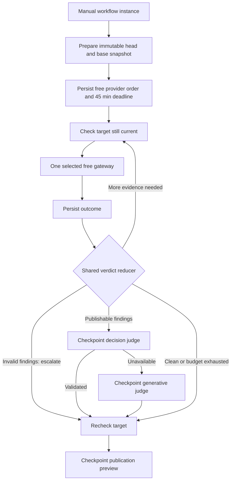

# Review Workflow prototype

Draft. No webhook activation, paid inference, status mutation or review
publication.

## Flow

- Existing context collection, review prompt, verifier, cooldown store and
  provider order.
- Shared sweep verdict reducer; legacy DO scheduling unchanged.
- One provider per durable step; 7 min request ceiling, 8 min step timeout.
- No automatic Workflow step retry; router model fallback remains enabled.
  Completed checkpoints replay without new API calls.
- Persisted snapshot/outcome: outer JSON under 900 KB, line sets explicitly
  serialized.
- Empty or malformed free order fails closed; unavailable gateways advance to
  the next step.
- Freshness checks: at most 30 seconds, bounded by remaining sweep budget.
- Deadline expiry during freshness or the last request persists a budget stop.
- Free-only alias + strict provider selection. Workers AI disabled for L1/L2.
- Route checkpoint requires router capability flag; old deployments fail closed.
- L2 decision: 40s; generative fallback: 5 min, separate from free budget.
- Head freshness before each judge; fail open on inference errors only.
- Shared publication planner, legacy GitHub submission unchanged.
- Preview checkpoints metadata only: comment, silent, escalate or skip.
- Manual instances enforce both repository allowlists.
- GitHub fetches are read-only except installation-token minting.
- Integration test: real preparation, strict binding calls and checkpoint replay.
- Diagnostic result is not a published or certified review.

## Manual binding smoke

Start an instance with params `{"mode":"binding-smoke"}` once both Workers
are deployed and router health reports at least one configured non-Workers-AI
free review provider. Expect mode `binding-smoke`, status `completed` and a positive
provider count. Only router health and synthetic checkpoint serialization;
no GitHub access or inference. Legacy alarms remain active.

## Rollback

- Keep the existing `WebhookReviewJob` alarm and `runWebhookReview` live.
- No production scheduler switch in this prototype. Manual Workflow only.
- Future opt-in must default to the alarm path; drain or cancel Workflow
  instances before switching back. Never publish from both runners.

## Before activation

- Deploy router with strict selector before manual smoke. Keep it deployed
  while prototype instances run. Cancel or drain instances before rollback.
- Validate Workflow CPU and state size on Free tier with a real review. If
  context collection exceeds CPU budget, move expensive work behind existing
  service/DO; consider R2 for larger snapshots.
- Measure real free provider latency, context size and step consumption.
- Add DO-owned instance identity (repository + PR + head + base), deduplication,
  cancellation on supersession, completion reconciliation and status bridge.
- Connect shared publication plan to DO-owned submission gate.
- Paid inference: no automatic retry; durable receipt before live activation.
- Keep stored source/evidence private; define retention and deletion before
  production use.
- No second routing config. Wrangler review order remains canonical.

References:

- [API](https://developers.cloudflare.com/workflows/build/workers-api/)
- [Rules](https://developers.cloudflare.com/workflows/build/rules-of-workflows/)
- [Limits](https://developers.cloudflare.com/workflows/reference/limits/)
